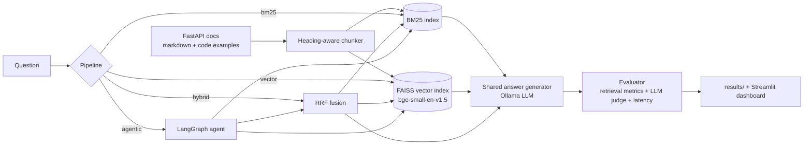
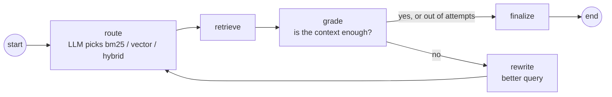

# Agentic RAG Benchmarking System

Benchmarks **BM25, vector, hybrid and agentic** retrieval-augmented generation (RAG) pipelines for
domain-specific question answering on the **FastAPI documentation**, using only **open-source models**
(served locally by [Ollama](https://ollama.com)).

The agentic pipeline is a **LangGraph** workflow that picks a retrieval strategy for each question,
checks whether the retrieved context is good enough, and rewrites the query and retries when it is not.
Every pipeline is scored on **faithfulness, relevance, correctness, latency and retrieval accuracy**.

## Architecture



### The agentic workflow (LangGraph)



- **route**: keyword-style questions (identifiers, status codes, flags) go to BM25, paraphrased or
  conceptual questions go to vector search, and mixed questions go to hybrid. If the LLM's reply is
  invalid, a rule-based router decides instead.
- **grade**: the LLM checks the passages against the *original* question.
- **rewrite**: the LLM uses the grader's reason to write a better query in FastAPI terminology.
- **finalize**: keeps the passing attempt; if no attempt passed, it fuses all attempts with RRF.

Every decision is logged in a trace that you can view in the dashboard.

## Metrics

| Group | Metric | How |
|---|---|---|
| Retrieval accuracy | Hit@k, Recall@k, Precision@k, MRR, nDCG@k | against the gold chunk of each question |
| | Doc-Hit@k, Doc-MRR | looser check: any chunk from the correct page counts |
| Faithfulness | supported claims / total claims | LLM judge splits the answer into claims and checks each against the context |
| Relevance | answer relevance (1-5 → 0-1) | LLM judge |
| Correctness | agreement with reference answer (1-5 → 0-1) | LLM judge |
| Abstention | "I don't know" rate | regex |
| Latency | p50 / p95 of retrieval, generation, total | `time.perf_counter` |
| Cost | prompt/completion tokens, LLM calls per question | Ollama usage counters |

## Quick start

```powershell
# 1. Python env
py -3.11 -m venv .venv
.venv\Scripts\activate
pip install -r requirements.txt

# 2. Open-source LLM (install Ollama from https://ollama.com first)
ollama pull qwen2.5:3b

# 3. Data + indexes
python -m scripts.download_docs
python -m scripts.build_index

# 4. Try it
python -m scripts.ask "How do I make a query parameter optional?" --pipelines bm25 vector hybrid agentic

# 5. Build the gold Q&A set (then review data/eval/qa_gold.jsonl by hand)
python -m scripts.generate_qa --n 100

# 6. Benchmark
python -m src.evaluation.runner --limit 10 --no-judge   # smoke test
python -m src.evaluation.runner                         # full run

# 7. Explore
streamlit run dashboard/streamlit_app.py
uvicorn src.api.app:app --reload                        # POST /query {"question": "...", "pipeline": "agentic"}

# Tests (no LLM needed)
pytest -q
```

## Project layout

```
configs/default.yaml        all settings (models, chunking, top-k, agent attempts)
scripts/                    download_docs, build_index, generate_qa, ask
src/ingest/                 markdown loader (inlines code examples), chunker, chunk store
src/retrievers/             bm25.py, vector.py, hybrid.py (RRF)
src/agent/graph.py          LangGraph agentic retriever
src/generation/             Ollama client, prompts, shared answer generator
src/evaluation/             retrieval metrics, LLM judge, benchmark runner
src/pipeline.py             pipeline factory
src/api/app.py              FastAPI service
dashboard/streamlit_app.py  benchmark dashboard + live query
tests/                      unit tests (fake LLM, no network)
```

## Results

_Run the benchmark and paste `results/<run>/summary.csv` here._

| Pipeline | Hit@5 | MRR | Faithfulness | Relevance | Correctness | p50 latency |
|---|---|---|---|---|---|---|
| BM25 | | | | | | |
| Vector | | | | | | |
| Hybrid | | | | | | |
| Agentic | | | | | | |

## Design notes

- **Fair comparison:** every pipeline uses the same chunks, the same top-k and the same answer
  prompt, so only retrieval differs.
- **Two question types:** the gold set mixes *keyword* questions, which reuse exact API names and
  favour BM25, with *conceptual* questions, which are paraphrased and favour vector search. This
  shows whether the router really adapts to the question.
- **Judge bias:** the judge is an LLM too. For stronger results, set `llm.judge_model` to a larger
  model than the generator and hand-review a sample of the judgements.
