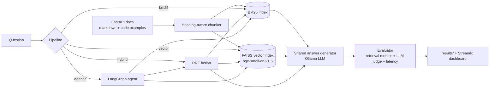
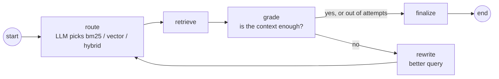

# Agentic RAG Benchmarking System

Benchmarks **BM25, vector, hybrid and agentic** retrieval-augmented generation (RAG) pipelines for
domain-specific question answering on the **FastAPI documentation**, using only **open-source models**
(served locally by [Ollama](https://ollama.com)).

The agentic pipeline is a **LangGraph** workflow that picks a retrieval strategy for each question,
checks whether the retrieved context is good enough, and rewrites the query and retries when it is not.
Every pipeline is scored on **faithfulness, relevance, correctness, latency and retrieval accuracy**.

## Architecture



### The agentic workflow (LangGraph)



- **route**: keyword-style questions (identifiers, status codes, flags) go to BM25, paraphrased or
  conceptual questions go to vector search, and mixed questions go to hybrid. If the LLM's reply is
  invalid, a rule-based router decides instead.
- **grade**: the LLM checks the passages against the *original* question.
- **rewrite**: the LLM uses the grader's reason to write a better query in FastAPI terminology.
- **finalize**: keeps the passing attempt; if no attempt passed, it fuses all attempts with RRF.

Every decision is logged in a trace that you can view in the dashboard.

## Metrics

| Group | Metric | How |
|---|---|---|
| Retrieval accuracy | Hit@k, Recall@k, Precision@k, MRR, nDCG@k | against the gold chunk of each question |
| | Doc-Hit@k, Doc-MRR | looser check: any chunk from the correct page counts |
| Faithfulness | supported claims / total claims | LLM judge splits the answer into claims and checks each against the context |
| Relevance | answer relevance (1-5 → 0-1) | LLM judge |
| Correctness | agreement with reference answer (1-5 → 0-1) | LLM judge |
| Abstention | "I don't know" rate | regex |
| Latency | p50 / p95 of retrieval, generation, total | `time.perf_counter` |
| Cost | prompt/completion tokens, LLM calls per question | Ollama usage counters |

## Quick start

```powershell
# 1. Python env
py -3.11 -m venv .venv
.venv\Scripts\activate
pip install -r requirements.txt

# 2. Open-source LLM (install Ollama from https://ollama.com first)
ollama pull qwen2.5:3b

# 3. Data + indexes
python -m scripts.download_docs
python -m scripts.build_index

# 4. Try it
python -m scripts.ask "How do I make a query parameter optional?" --pipelines bm25 vector hybrid agentic

# 5. Build the gold Q&A set (then review data/eval/qa_gold.jsonl by hand)
python -m scripts.generate_qa --n 100

# 6. Benchmark
python -m src.evaluation.runner --limit 10 --no-judge   # smoke test
python -m src.evaluation.runner                         # full run

# 7. Explore
streamlit run dashboard/streamlit_app.py
uvicorn src.api.app:app --reload                        # POST /query {"question": "...", "pipeline": "agentic"}

# Tests (no LLM needed)
pytest -q
```

## Bring your own documents

FastAPI is the built-in **benchmark** corpus. You can add any other document set, such as research
papers, internal docs or manuals, as a separate **corpus** with its own index, test questions and results.

Supported formats: **PDF, DOCX, Markdown, TXT and HTML**. Section headings are recovered from PDF
font size and bold text, DOCX heading styles and HTML `<h1>`–`<h4>` tags. For PDFs, repeated page
headers and footers, page numbers and the references section are removed.

**From the dashboard** (📁 Documents tab): upload files → **Build corpus** → **Generate questions**
→ **Run benchmark**. The report appears in the 📊 Report tab.

**From the command line:**

```powershell
python -m scripts.build_index --corpus papers --input C:\path\to\pdfs --domain "LLM research papers"
python -m scripts.ask "What is the main contribution?" --corpus papers --pipelines hybrid agentic
python -m scripts.generate_qa --corpus papers --n 30
python -m src.evaluation.runner --corpus papers
```

Each corpus is stored in `data/corpora/<name>/` and its results in `results/<name>/<run>/`.

## The report

Every benchmark run writes `results/<corpus>/<run>/`:

| File | Contents |
|---|---|
| `report.md` | key findings (best pipeline per metric, agent vs best baseline, latency cost), quality and latency tables, Hit@k by question type, agent routing statistics and missed questions |
| `summary.csv` / `summary_by_type.csv` | per-pipeline averages and p50/p95 latency |
| `records.jsonl` | one row per question × pipeline: answer, retrieved chunks, scores, agent trace |

The dashboard's **📊 Report** tab shows the same content with charts, plus download buttons.
The **🔍 Question explorer** tab compares all four pipelines side by side for a single question.

## Deploy a free public demo (Hugging Face Spaces)

`deploy/huggingface/` holds a Docker Space that runs Ollama (`qwen2.5:1.5b` on CPU) and the
dashboard in **demo mode** (`DEMO_MODE=1`), which is safe to expose publicly:

- **Limited uploads:** ≤ 3 files, ≤ 10 MB each, ≤ 100 PDF pages in total, ≤ 350k characters. Each
  visitor's corpus is visible only in their own browser session and is deleted after 60 minutes.
- **No background jobs:** question generation and the LLM-judged benchmark need a GPU and stay local.
- **Rate limits:** 10 LLM questions per session, one request at a time. The *retrieval-only* compare
  mode (BM25 vs vector vs hybrid) is fast and unlimited.

1. Create a free account at [huggingface.co](https://huggingface.co) → **New Space** → SDK **Docker** → *Blank*.
2. In the Space, upload `deploy/huggingface/Dockerfile` and `deploy/huggingface/README.md` to the
   Space's root folder (Files → Add file).
3. The Space builds the image itself: it clones this repo, builds the index and downloads the model
   (about 10–15 minutes the first time). The published benchmark runs in `results/fastapi/` appear in
   the Report tab.

To test the same image locally:

```powershell
docker build -f deploy/huggingface/Dockerfile -t agentic-rag-space .
docker run --rm -p 7860:7860 agentic-rag-space    # then open http://localhost:7860
```

Free Spaces have 2 vCPUs and no GPU, and go to sleep after about 48 hours without visitors. The
benchmark numbers come from a local GPU run, not from the Space.

## Project layout

```
configs/default.yaml        all settings (models, chunking, top-k, agent attempts)
scripts/                    download_docs, build_index, generate_qa, ask
src/ingest/                 FastAPI markdown loader, multi-format loaders (PDF/DOCX/HTML/TXT), chunker, store
src/corpus.py               corpora: per-corpus paths, build from uploaded files
src/evaluation/report.py    Markdown benchmark report
src/retrievers/             bm25.py, vector.py, hybrid.py (RRF)
src/agent/graph.py          LangGraph agentic retriever
src/generation/             Ollama client, prompts, shared answer generator
src/evaluation/             retrieval metrics, LLM judge, benchmark runner
src/pipeline.py             pipeline factory
src/api/app.py              FastAPI service
dashboard/streamlit_app.py  benchmark dashboard + live query
tests/                      unit tests (fake LLM, no network)
```

## Results

**Pilot run** on the FastAPI docs: 12 generated questions (6 keyword, 6 conceptual), top-k = 5.
The generator is `qwen2.5:3b` and the judge is `llama3.2:3b`, a different model family to avoid
self-preference bias. Everything ran locally on a GTX 1650 (4 GB).
Full report: [`results/fastapi/demo_12q/report.md`](results/fastapi/demo_12q/report.md).

| Pipeline | Hit@5 | MRR | nDCG@5 | Faithfulness | Relevance | Correctness | p50 latency | LLM calls |
|---|---|---|---|---|---|---|---|---|
| BM25 | 0.917 | 0.854 | 0.869 | **0.963** | 0.917 | 0.854 | 9.7 s | 1 |
| Vector | 0.833 | 0.750 | 0.772 | 0.955 | 0.958 | 0.875 | 8.6 s | 1 |
| Hybrid (RRF) | **1.000** | **0.892** | **0.918** | 0.948 | 0.917 | 0.854 | **7.7 s** | 1 |
| Agentic (LangGraph) | 0.917 | 0.736 | 0.783 | 0.959 | **0.979** | **0.938** | 34.2 s | 7.5 |

**What the pilot shows**

- **Hybrid retrieval is the strongest retriever:** it found the gold chunk for every question and
  had the best ranking (MRR 0.892). BM25 missed paraphrased questions and vector search missed
  exact-identifier ones; fusing both fixed both.
- **The agent gives the best answers** (correctness 0.938, +6.2 points over the best baseline, and
  the highest relevance), but it costs **4.5× the latency** and 7.5 LLM calls per question.
- **The router adapts to question type:** it chose vector or hybrid for 6 of 6 conceptual questions and
  BM25 or hybrid for 4 of 6 keyword questions.
- **The grader is too strict:** it accepted only 25% of first retrievals, so most questions went
  through 2–3 retrieve→rewrite cycles. Tuning the grader is the main lever for cutting latency.
- **Limitation:** 12 questions is a small sample, so differences of one question (8.3 points)
  are within noise. The next step is the full 100-question run.

A second copy of the same answers scored by `qwen2.5:3b` as the judge is in
[`results/fastapi/compare_qwen_judge/`](results/fastapi/compare_qwen_judge/) for comparing the two judges.

## Design notes

- **Fair comparison:** every pipeline uses the same chunks, the same top-k and the same answer
  prompt, so only retrieval differs.
- **Two question types:** the gold set mixes *keyword* questions, which reuse exact API names and
  favour BM25, with *conceptual* questions, which are paraphrased and favour vector search. This
  shows whether the router really adapts to the question.
- **Judge bias:** the judge is an LLM too. For stronger results, set `llm.judge_model` to a larger
  model than the generator and hand-review a sample of the judgements.
